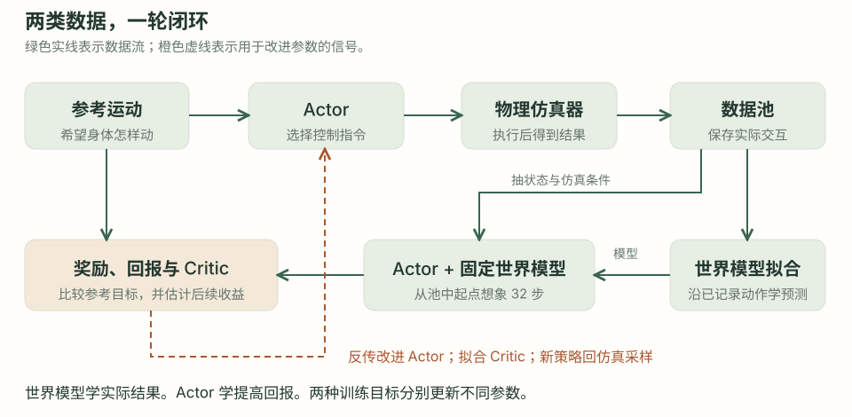
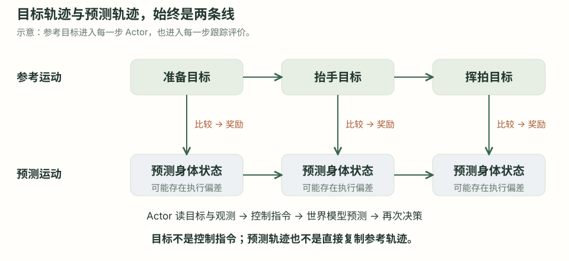
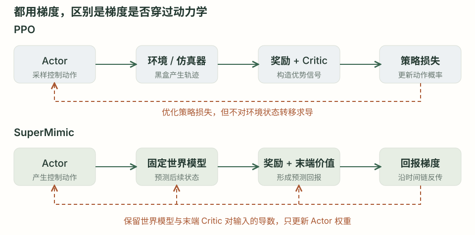
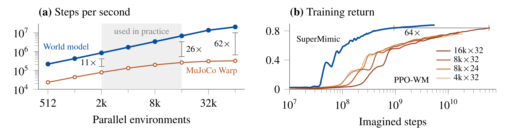
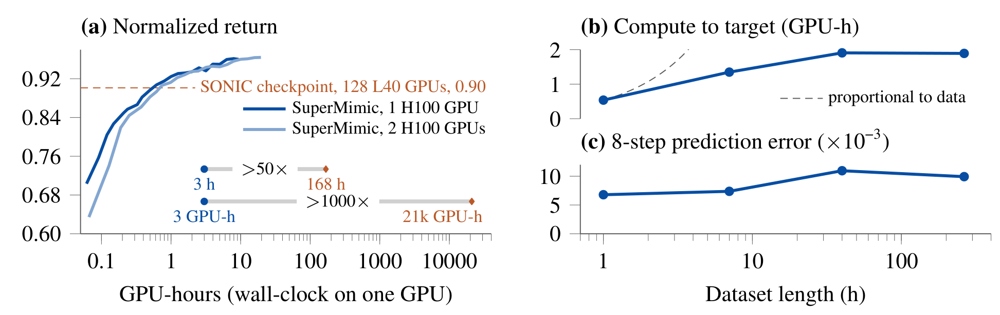
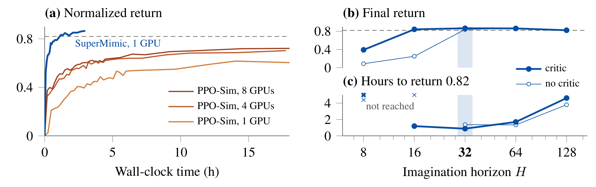
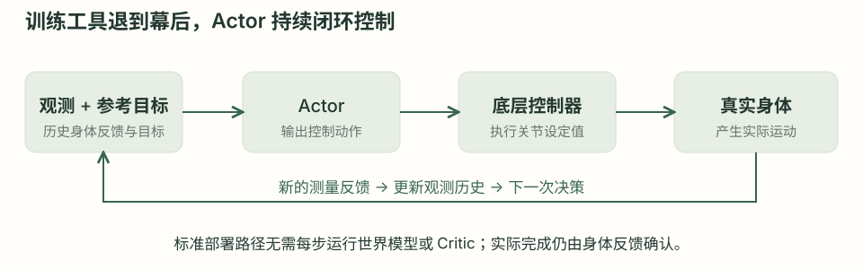

# SuperMimic 学习笔记：从运动跟踪到可微世界模型

让机器人复现一段挥拍动作，难点不止是知道手应该放在哪里，还包括怎样发出控制指令，才能让身体真正到达那里。SuperMimic 学习一个以参考运动为目标的控制策略，并用可微世界模型提高训练效率。世界模型负责预测指令的后果，策略负责选择指令，两者在训练中交替改进。

本文以“抬手、转身、挥拍”为教学例子，先区分目标与控制，再追踪一轮训练，最后解释论文中的速度结果。挥拍例子不是论文独立验证的羽毛球任务。正文依据 **SuperMimic: Scaling Humanoid Whole-Body Control with One Differentiable World Model**，arXiv:2610.28480v1；整理日期为 2026 年 11 月 10 日。论文实验均按作者报告解读，本文没有复现训练。

## 01 · 先明确任务：学会跟踪一段运动 {#task}

假设已经有一段机器人可以使用的参考运动：准备姿势、抬手、转身、挥拍、收拍。它描述身体希望经过的姿态和轨迹，却没有直接回答：此刻各个关节应该收到什么指令？

机器人会有惯性、驱动响应和地面接触。即使目标相同，身体已经向右倾斜时，控制指令也可能需要变化。**运动跟踪策略就是根据当前身体情况，持续选择控制指令，让实际运动接近参考运动。** 它是一个闭环控制器，不是把一段关节角动画直接播放给机器人。

从人类视频出发，通常还需要运动重建、坐标处理和动作映射，才能把人的动作变为机器人可使用的参考运动。这些步骤在本文中是输入准备。SuperMimic 原论文使用已映射到 G1 的运动数据；它本身不负责从任意视频提取人体姿态。[依据：附录 A、E](https://arxiv.org/pdf/2610.28480#page=13)

### 挥拍动作与自主打球之间还隔着什么

跟踪“挥拍”解决身体怎样运动。自主打球还要知道球在哪里、何时到达、怎样选择落点，以及球拍与球接触后会发生什么。**复现打球姿势，不代表已经获得感知来球和自主击球能力。** 原论文训练限于平地，没有验证物体交互；但平地运动仍可以包含身体与地面的接触，例如侧翻滚。[依据：§4.4、§6](https://arxiv.org/pdf/2610.28480#page=9)

这决定了阅读方法时的重点：最终要学会的是跟踪策略，世界模型是帮助训练这个策略的工具。

## 02 · 分清输入：参考运动与交互数据 {#data}

“动作”容易指代两件不同的事。**参考运动**是希望身体呈现的运动；**控制动作**是策略这一步输出的控制指令。前者可以说“下一刻手臂应该抬起来”，后者必须落实到关节设定值。

| 名称 | 在这里表示什么 | 谁使用它 |
|---|---|---|
| 参考运动 / goal | 目标身体姿态、位置和速度随时间的序列 | Actor、奖励与终止计算、Critic |
| 观测 / observation | 关节与 IMU 等可供控制器使用的信息 | 部署时的 Actor |
| 状态 / state | 动力学预测及训练使用的身体状态描述 | 世界模型与 Critic |
| 控制动作 / action | 由 Actor 输出、映射为关节设定值的指令 | 仿真器或机器人底层控制器 |
| 仿真条件 / context | 摩擦、关节校准偏差、躯干质心偏移等 | 世界模型与 Critic |
| 数据池 / replay buffer | 保存已发生的仿真交互记录 | 模型拟合与想象起点采样 |

论文里的 Actor 接收**过去 10 帧本体观测与未来 10 帧参考运动**。观测包括相对默认姿态的关节位置、关节速度、基座角速度、投影重力和上一控制动作。参考运动先编码成目标表示，再与观测历史一起用于产生动作。[依据：附录 A、表 A.4](https://arxiv.org/pdf/2610.28480#page=15)

同样是站立、手臂下垂，目标是挥拍和目标是踢腿时，Actor 可以给出不同指令。**输入目标并不是 SuperMimic 独有的能力；用 PPO 训练的 Actor 也可以接收目标。** 两者的核心区别在更新策略的方法，后文再展开。

### 两类数据分别给出目标和事实

参考运动提供“希望怎样动”；交互记录提供“发出某条指令后实际怎样动”。训练世界模型的动力学部分时，要学第二件事。

教学例子：参考运动要求手臂到达 60°，Actor 发出一组指令，仿真器执行后实际只到了 40°，身体还向右倾斜。世界模型的监督答案应该是 **40° 和身体右倾**。如果把参考目标 60° 当成实际结果，它就没有学到真实的控制后果。

参考目标仍会影响世界模型看到什么：Actor 正在尝试挥拍，数据池里便会出现挥拍尝试附近的状态和指令，包括没做好甚至摔倒的结果。**采样与任务有关，模型监督却必须忠于实际发生的转移。** 动力学预测部分的输入是状态、控制动作与仿真条件；参考目标另用于奖励和终止等任务相关计算。[依据：§3.1–3.2](https://arxiv.org/pdf/2610.28480#page=4)

## 03 · 走完一轮训练：谁提供数据，谁更新参数 {#loop}

先看整体闭环。仿真器提供交互结果，数据池把这些结果保存下来，世界模型学习预测。随后 Actor 在暂时固定的模型里尝试动作，利用预测回报改进自己；Critic 学习估计更远的收益。新策略再回到物理仿真器，产生下一轮数据。

这张图是对原论文图 2 和算法 A.1 的教学重绘。原论文算法把整体组织为采集、模型拟合、策略改进三段；下面为了解释，把想象推演、Actor 更新和 Critic 更新进一步展开。[依据：算法 A.1](https://arxiv.org/pdf/2610.28480#page=15)

1. **采样。** 当前 Actor 接收观测和参考目标，输出指令并加入动作探索噪声；物理仿真器执行，得到下一状态。把状态、实际执行的指令及结果等写入数据池。
2. **拟合世界模型。** 从池里抽连续 8 步窗口，使用窗口内已经执行过的动作进行自回归预测；比较预测与记录，更新世界模型。
3. **生成想象轨迹。** 从池里抽起始状态及记录的仿真条件。Actor 重新出动作，世界模型预测下一状态；根据新的预测观测再出动作，连续展开 32 步。
4. **更新 Actor。** 从预测奖励和末端价值构成的目标出发，沿推演链反向传播，只改变 Actor 的参数。
5. **更新 Critic。** 用想象轨迹构造固定的回报目标，调整 Critic，使其价值预测接近这些目标。
6. **进入下一轮。** 新 Actor 再去仿真器尝试，补充记录，再次拟合模型。

<!-- TIMELINE -->

### 读懂时间流的两个时间尺度

上层阶段表示一轮训练的计算顺序；下层的“第 1 次出动作、第 1 次预测……”表示想象轨迹内部的时间推进。列宽不代表计算耗时。模型拟合本身包含多个批次，Critic 拟合也包含多个 epoch；“更新一次”在这里表示一个训练阶段，不是一条样本的一次算术运算。

Critic 的状态估值与奖励在图中集中到相邻列便于阅读，实际计算依赖遍布轨迹。不要把这张教学展开图理解为逐行精确复刻实现的调度表。

### 两段训练使用的轨迹不同，但并不脱节

模型拟合使用的是**已经发生的仿真轨迹**；策略与 Critic 更新使用的是**刚生成的想象轨迹**。二者由数据池起点和已学习的动力学连接：后者从前者的状态出发，却由当前 Actor 重新选择后续动作。

数据池并不是专家示范库，也不是模型权重。它保存最近的交互记录，容量满后替换最旧数据。Actor 的观测历史则是每次决策使用的短期输入，和数据池不是同一种“记忆”。[依据：§3.1、算法 A.1](https://arxiv.org/pdf/2610.28480#page=15)

## 04 · 世界模型：学到哪一部分物理，为什么继续更新 {#world-model}

### 起点有任务背景，探索也不是随意挑动作类别

仿真回合从参考运动库中的时间点复位。论文把运动时间线分为 1 秒区间：50% 的复位按区间均匀采样，40% 优先当前回报低的区间，10% 按过去累计的困难采样权重选择，使已经学会的困难片段仍有练习机会。这里不是在所有可能的关节空间中毫无约束地乱选姿势。[依据：附录 D.1](https://arxiv.org/pdf/2610.28480#page=15)

如果训练库只有挥拍片段，就从准备、抬手、挥拍、收拍等阶段选起点；Actor 根据这段参考运动出指令，再加探索噪声。起点不仅涉及空间位置，还要对应运动中的身体状态。**想象推演的起点则从数据池抽取**，可能是没跟好、已经有偏差的状态，而不是只取完美参考姿态。

在多动作训练中，踢腿和挥拍都由同一副身体完成，其关节响应与接触动力学可能共享。但这不保证加入任意无关数据都会改善指定动作。对单一挥拍任务优先覆盖相关状态与执行偏差，是工程判断，不是论文已经做出的最优数据配比结论。

### 8 步是拟合窗口，32 步是策略推演长度

模型拟合时，第一步从记录状态开始，预测结果继续作为后一步的状态输入，控制动作则一直使用窗口中记录的动作。这叫多步自回归拟合。它不是每一步都拿真实下一状态重新开始预测。

策略推演时，动作也变了：每一步都是当前 Actor 根据模型预测的观测与对应参考目标重新生成。**不能把它理解为只采一次初始动作，然后世界模型独自往后播放 32 步。**

深入阅读：动力学输入、监督目标和窗口误差

用预测状态、控制动作与仿真条件表示一步动力学。ω 是模型参数；ξ 是该回合记录的仿真条件；带帽状态表示模型预测值。

$$
\hat{s}_{t+1}=f_{\omega}(\hat{s}_t,a_t,\xi)
$$

从记录起点开始，在 8 步窗口中沿记录动作展开。下式只展示状态预测这一项，说明监督来自实际记录；原论文 Eq. 1 还包含可学习的奖励、观测和终止头损失，解析头没有参数损失。

$$
\begin{aligned}
\hat{s}_0&=s_0,\\
\mathcal{L}_{\mathrm{state}}&=\mathbb{E}_{B}\left[\sum_{j=1}^{8}\|\hat{s}_j-s_j\|^2\right]
\end{aligned}
$$

普通状态是池中记录的监督答案，不随这个模型优化步骤变化。目标是降低预测偏差，不是提高动作跟踪奖励。模型与策略的损失因此承担不同职责。[依据：§3.2](https://arxiv.org/pdf/2610.28480#page=5)

### 持续更新不意味着模型只能记住当前动作

论文采用同一个世界模型服务多种运动。它拟合的是多批数据中的共同身体和接触动力学，不是每练一个动作就换一个专属模型。但“学习仿真器的代理”也不意味着完整复刻仿真引擎：模型只在给定的状态、控制、随机化条件和数据覆盖范围内得到监督。

策略更新后可能访问新的姿态和控制组合，继续采数据可以补充模型在这些区域的依据。这是持续更新的机制解释。**不能仅凭模型仍在更新，就认定它参数太少、根本学不出物理规律；也不能仅凭一次预测准确，就认定任意新动作都可靠。** 数据覆盖、模型容量、优化效果与预测时域需要分别考察。

### 原论文没有先完成一套独立的世界模型预训练

算法 A.1 中，采集、拟合和策略改进反复交替。每轮先拟合再改善策略，不等于在整项任务开始前已经用离线专家数据预训练好模型。论文相关工作明确把这一点与使用其他策略轨迹预训练世界模型的 RWM / RWM-U 区分开。[依据：§2、算法 A.1](https://arxiv.org/pdf/2610.28480#page=3)

原论文没有在同一协议下单独比较“预训练后永久冻结”和“持续在线更新”两种方案。因此可以准确描述它的选择，不能据此宣称提前预训练必然更差，或冻结模型一定无法完成任务。独立预训练与后续继续更新也并不互斥。

## 05 · 奖励、回报与 Critic：训练答案从哪里来 {#reward-critic}

### 参考运动贯穿每一步，不只用来选起点

想象中有两条同步前进的轨迹：参考运动规定目标，模型预测实际控制后果。Actor 每一步接收目标；奖励把预测运动和对应参考运动比较；Critic 在估值时也接收目标。推演虽然发生在模型中，目标并没有消失。

这是一张教学示意图，位置与奖励并非真实实验记录。它强调“希望发生什么”和“预计发生什么”需要同时存在。

### 奖励是设计好的评分规则，逐步自动计算

奖励不需要人对每次挥拍手工打分。研究者定义规则，程序根据当前结果和参考目标计算得分。SuperMimic 的运动跟踪奖励沿用并修改 BeyondMimic：比较身体部位的位置、朝向、线速度、角速度，以及根部的位置与朝向，再加入动作平滑与关节限位项。

| 评价项 | 要鼓励或约束什么 | 论文中的权重 |
|---|---|---|
| 身体位置、朝向、线速度、角速度 | 各身体部位接近参考运动 | 四项各 1.0 |
| 根部位置、朝向 | 整体位置与方向接近参考 | 两项各 0.5 |
| 动作平滑 | 避免相邻控制指令突变 | −0.1 |
| 关节限位 | 惩罚越出关节范围 | −2 |

这些是公式各项的权重，不是最终奖励的固定占比；论文中各项还乘控制周期 0.02 秒。终止规则另根据根部高度和倾斜相对参考的偏差判断。动作跟踪得分不包含“羽毛球成功越网”这样的物体交互目标。[依据：表 A.2、附录 A、表 A.6 下方说明](https://arxiv.org/pdf/2610.28480#page=14)

深入阅读：一个跟踪奖励项如何由误差得到

下面是身体位置项。T 表示被跟踪的身体部位集合；p 是当前部位位置；上标 des 表示参考位置。先计算平均位置平方误差，再映射成随误差增大而下降的得分。其余跟踪项有各自的尺度。

$$
r_{\mathrm{body\ position}}=
\exp\left[-\frac{1}{0.3^2}\frac{1}{|T|}\sum_{b\in T}\|p_b^{\mathrm{des}}-p_b\|^2\right]
$$

这只是一个奖励分项，还没有加权汇总其他分项，也没有乘控制周期。在模型内，动力学先产生预测；奖励与终止可以采用学习头或解析计算，具体要按论文给出的接口理解，不应笼统写成“世界模型自己发明了奖励”。[依据：§3.2、表 A.2](https://arxiv.org/pdf/2610.28480#page=5)

### Critic 学的不是标准姿态，而是未来回报

抬手到位可以获得当前奖励，但如果身体已经快要倒下，接下来可能很难继续跟踪。Critic 估计的是：**从这个状态出发，继续按当前策略跟踪给定目标，后面大约还能获得多少折扣回报。** 它输出一个标量，不输出动作，也不是一个独立知道物理真相的裁判。

论文中的 Critic 是隐藏层宽度为 256、128 的多层感知机，输入状态、目标和仿真条件。训练答案由想象轨迹中的奖励与已有价值估计构成；模型偏差和旧 Critic 误差都可能进入这个目标。[依据：表 A.4、Eq. 3](https://arxiv.org/pdf/2610.28480#page=15)

先用一个**教学算例**建立直觉：三步奖励依次为 1、2、3，折扣取 0.9，并假设第三步之后真正终止，不再有未来奖励。

| 从哪个位置估计 | 后面将得到的奖励 | 折扣回报目标 |
|---|---|---|
| 第一步动作之前 | 1、2、3 | 5.23 |
| 第二步动作之前 | 2、3 | 4.70 |
| 第三步动作之前 | 3 | 3.00 |

第一个目标的计算是：

$$
G_0=1+0.9\times2+0.9^2\times3=5.23
$$

Critic 对第一个状态若预测 4.0，就用回归损失把它向目标 5.23 调整。这张表只是完整终止的折扣回报例子，**并非论文实际使用的全部目标算法**。SuperMimic 默认折扣为 0.99，使用参数为 0.95 的 GAE 回报目标；32 步推演结束只是计算截断，不等于任务终止，所以通常需要末端价值补上后续收益。

深入阅读：完整的 Critic 目标与边界条件

H 为想象长度 32。先用当次拟合之前的 Critic 计算各状态价值；末端回报目标取末端价值，再反向递推。预测奖励是想象中的一步得分；预测终止量用于停止后续回报；γ 是折扣，λ 控制一步自举与更长回报的混合。

$$
V_t=V_\psi(\hat{s}_t,g_t,\xi),\qquad \hat{R}_H=V_H
$$

$$
\begin{aligned}
\hat{R}_t&=\hat{r}_{t+1}+\gamma(1-\hat{d}_{t+1})\\
&\quad\cdot\left[(1-\lambda)V_{t+1}+\lambda\hat{R}_{t+1}\right]
\end{aligned}
$$

全部目标每条 rollout 计算一次，在 Critic 拟合期间固定。下面的 stopgrad 表示不要通过训练目标再修改目标的计算链；e 表示价值预测与固定目标的误差。优化只改变价值预测对应的 Critic 参数。

$$
\begin{aligned}
e_t&=V_t-\operatorname{stopgrad}(\hat{R}_t),\\
\mathcal{L}_V(\psi)&=\mathbb{E}\left[\sum_{t=0}^{H-1}e_t^2\right]
\end{aligned}
$$

真实终止时不再接续未来价值；仅到达想象长度边界时仍保留自举。这是为什么不能把“三步示例的最后目标是 3”直接套到每一条 32 步想象轨迹末尾。论文每次 Critic 更新使用 5 个 epoch，每个 epoch 分成 4 个打乱的小批次；未使用指数移动平均目标网络。[依据：§3.3、表 A.5](https://arxiv.org/pdf/2610.28480#page=5)

## 06 · 与 PPO 对照：梯度到底经过哪里 {#ppo}

PPO 和 SuperMimic 都可以有 Actor、Critic、参考目标和奖励，也都通过梯度优化网络。不能把区别概括成“PPO 不用梯度”或“PPO 不知道目标”。关键是策略改进信号怎样获得。

PPO 根据采样动作的优势等信号调整动作概率，并用裁剪等机制限制策略改变幅度。它把环境转移当作黑盒，不需要对仿真器的物理计算求导。SuperMimic 则把预测回报沿动作、状态和世界模型的计算链反向传播，利用“这条指令改变一点，未来得分会怎样变化”的导数来更新 Actor。

这个对照说明更新路径，不表示两者使用相同实验配置或一定谁更好。SuperMimic 的 Critic 用 GAE 回报目标训练，也不意味着它的 Actor 就在执行 PPO 的优势加权更新。[依据：§3.3](https://arxiv.org/pdf/2610.28480#page=5)

### 冻结模型参数，保留模型对输入的导数

为了让预测结果更符合记录而修改世界模型，是模型拟合阶段的工作。为了让未来得分更高而修改 Actor，是策略改进阶段的工作。第二阶段固定世界模型权重，仍然需要它提供“动作变化如何影响下一状态”的导数。

否则，如果为了提高预测奖励连世界模型也一起改，就可能把“不稳的控制指令会导致失衡”改成“不会失衡”，只是把预测改得好看。**固定参数并不等于把模型整段放在不求导的计算里；切断输入梯度就失去了这条策略学习路径。** Critic 在 Actor 更新时同样固定参数，但末端价值对状态的导数仍参与反传。

深入阅读：Actor 目标与 BPTT 的含义

Actor 在每个预测观测上重新出动作，目标随参考时间推进。η 表示外加的传感器噪声，θ 是策略参数。

$$
a_t=\pi_\theta(\hat{\bar{o}}_t+\eta_t,g_t)
$$

Actor 最大化短时域奖励与末端 Critic 价值之和。论文用生存权重处理终止；下式中的 ĉ 是到对应时间的生存权重，H 为推演长度。

$$
\begin{aligned}
\hat{J}(\theta)=\mathbb{E}\bigg[&\sum_{t=0}^{H-1}\gamma^t\hat{c}_t\hat{r}_{t+1}\\
&+\gamma^H\hat{c}_H V_\psi(\hat{s}_H,g_H,\xi)\bigg]
\end{aligned}
$$

优化方向来自这个目标对 θ 的导数。BPTT（通过时间的反向传播）沿展开的多步计算图传播梯度；它不要求 Actor 本身必须是循环神经网络。模型权重与 Critic 权重在这次求导时固定，动作和状态之间的依赖保留。该梯度属于学习代理中的回报目标，模型错误也可能使改进方向偏离实际环境。[依据：Eq. 2、§3.3](https://arxiv.org/pdf/2610.28480#page=5)

## 07 · 为什么训练快：拆开四种不同的“快” {#speed}

世界模型也有拟合成本，使用它并不会自动得到更短的完整训练时间。理解 SuperMimic 的结果，要分别看一次推演有多便宜、达到某个回报需要多少步、训练循环总耗时多少，以及总共用了多少 GPU 小时。

这里的“归一化回报”是整回合逐步奖励之和，除以该总和的最大可能值；提前终止会拉低得分。它是跟踪质量指标，不等于任务成功率。训练回报与固定检查点评估还可能采用不同的起点分布，比较图表时需要保留这个区别。[依据：§4](https://arxiv.org/pdf/2610.28480#page=6)

图源：原论文第 8 页 Figure 5。左图是一秒能生成多少个控制步，右图是达到某个训练回报需要多少想象步。**这两个倍率不能直接相乘当作总训练加速比。**

### 一次模型推演比一次物理仿真便宜

论文的世界模型预测结构化身体状态，不生成视频。在 H100 上，常用的 2k–16k 并行规模中，模型轨迹吞吐超过 MuJoCo Warp 的 10 倍；在 64k 并行规模下达到 62 倍。这里“一步”是 50 Hz 的一个控制步；物理仿真用四个 5 ms 子步完成，学习模型直接预测该控制间隔之后的状态。[作者报告结果：Figure 5(a)](https://arxiv.org/pdf/2610.28480#page=8)

### 更直接的更新信号减少所需想象步数

为了区分“模型便宜”和“更新方法有效”，论文让 PPO 也使用世界模型轨迹，称为 PPO-WM。在 LAFAN1 的走、跑、冲刺运动上，SuperMimic 达到 PPO-WM 最佳训练回报所需的想象步数约少 64 倍。它支持策略更新机制的收益，而不是完整任务普遍快 64 倍的结论。[作者报告结果：Figure 5(b)](https://arxiv.org/pdf/2610.28480#page=8)

### 同一副身体，让多种运动共享模型

从走路到下蹲，目标在变，身体的关节和接触规律仍有可复用部分。论文将运动数据规模从 1 小时扩大到 264 小时，8 步状态预测误差保持在约 0.007–0.011，达到目标回报的 GPU 小时增长较慢。这些误差是按预设尺度归一化、在训练策略轨迹上测量的状态误差；不是厘米，也不是所有未见状态上的保证。[作者报告结果：Figure 3](https://arxiv.org/pdf/2610.28480#page=7)

图源：原论文第 7 页 Figure 3。模型共享使训练成本可以在多种运动间分摊，是作者对规模结果的解释。它并不证明任意新增数据都无成本，也不等于一次离线预训练后永久冻结。

### Critic 使较短推演仍能考虑后续收益

默认 32 步在 50 Hz 下对应约 0.64 秒。Critic 把更远的收益压缩成末端价值，减少为看见长期结果而展开长链的需要。论文在 LAFAN1 的 40 条运动、2.45 小时数据上比较不同推演长度：有 Critic 时，16 步可达到无 Critic 的 32 步水平；默认 32 步达到所选目标回报最快。128 步比 64 步达到目标所需时间接近三倍，最终回报反而下降。[作者报告结果：§4.3、Figure 4](https://arxiv.org/pdf/2610.28480#page=8)

图源：原论文第 7 页 Figure 4。图 (a) 是检查点对全部 40 条动作的评估；图 (b)(c) 使用训练回报。困难片段复位会改变训练起点分布，因此两种回报不应直接混读。作者还在仿真静态 T-pose 推扰测试中观察到带 Critic 的策略恢复更好，说明它不只是用于省计算。

### “三小时”和“超过千倍”应该怎样读

| 比较问题 | 原论文报告 | 解释边界 |
|---|---|---|
| 与 SONIC 发布检查点比较 | 一张 H100 训练 3 小时超过其归一化回报 | SuperMimic 用 264.56 小时数据，SONIC 用 611 小时；硬件也不同 |
| 完整计算账目 | SONIC 报告 128 张 L40、7 天；对照 SuperMimic 的 1 张 H100、3 小时 | 约 56 倍墙钟时间和 7200 倍 GPU 小时差距，不是隔离后的算法常数 |
| 共同运动库中的失败数 | 129,514 条运动上，SuperMimic 单卡 3 小时为 25；双卡 9.8 小时为 0；SONIC 发布检查点为 179 | 这些动作属于 SuperMimic 的训练运动库；“零失败”不是未见动作或任意实机任务保证 |
| 受控 PPO-Sim 比较 | LAFAN1 上，SuperMimic 单卡 1.2 小时达到评估回报 0.82；PPO-Sim 在 18 小时预算内未达到 | 有明确任务与配置，不应外推到全部强化学习问题 |

SuperMimic 的三小时包含模型拟合和策略学习的完整训练循环；训练后检查点评测不计入。GPU 小时衡量设备数量乘时间，不能消除不同 GPU 型号的算力差异。PPO-Sim 对照共享动作库、观测、奖励、终止、随机化、网络大小和评估协议，但每 GPU 的并行环境数不同。[依据：§4.1](https://arxiv.org/pdf/2610.28480#page=6)

这些结果支持“在本文运动跟踪设置下显著提高训练效率”。它们没有直接验证“所有强化学习快千倍”，也没有比较同条件下预训练冻结模型与持续更新模型的优劣。论文没有在这些图中报告随机种子方差，因此仅从曲线也不能读出完整不确定性。

## 08 · 研究贡献：已有路线怎样走到大规模机器人跟踪 {#contribution}

“用世界模型训练策略”不是 SuperMimic 首创。原论文主动把自身放在可微运动控制、模型强化学习与机器人迁移的交叉位置。下面只概括原论文相关工作中的定位，不引入社区评价或后续实现。

| 原论文讨论的路线 | 已有基础 | SuperMimic 与它的关系 |
|---|---|---|
| SuperTrack、ControlVAE、SuperDyno 等 | 学习可微动力学并通过它训练角色运动控制 | 延续这条路线，推进到大规模人形机器人跟踪与实机迁移 |
| Dreamer、DreamerV3、DayDreamer | 学习模型，利用想象进行行为学习；也已有实机世界模型研究 | 世界模型与想象学习具有前例，但表示和任务设置并不相同 |
| SHAC | 在可微仿真中用短时域 Actor–Critic 求策略梯度 | 为 Critic 自举的短时域目标提供方法背景；本文改用学习代理 |
| RWM、RWM-U | 在学习的神经仿真器中使用 PPO 训练可迁移策略 | 本文通过学习动力学直接反传，并用自身策略持续采样拟合模型 |

[依据：原论文 §2，第 3 页](https://arxiv.org/pdf/2610.28480#page=3)

本文的贡献可以理解为：**把可复用、可微的身体动力学与短时域策略学习组合起来，在大规模动作库上检验效率，并把控制器迁移到真实 G1。** 论文还通过模型误差、轨迹吞吐和策略更新消融解释部分收益来源。各项设计与证据共同构成贡献，而不是单独一个“世界模型”名词。

深入阅读：默认运动跟踪之外，论文还研究了什么

原论文还初步研究了速度目标接口：不同目标编码器共享动作解码器和世界模型，速度接口可以使用自己的速度跟踪奖励训练。它不再需要以完整参考运动作为唯一目标形式。该实验说明目标接口具有扩展可能，但不能推断所有任务都只需换一条奖励。

作者明确指出多接口训练仍研究不足；速度任务奖励只更新该目标编码器，不更新共享解码器。正文以默认的完整参考运动跟踪为主，不把这一初步实验扩写成已验证的通用任务能力。[依据：§4.5、附录 B、§6](https://arxiv.org/pdf/2610.28480#page=9)

## 09 · 部署与边界：如何联系到 S2 遥操数据 {#deployment}

### 训练结束后，部署的主角是 Actor

标准运动跟踪部署持续读取机器人本体观测和参考目标，通过 Actor 输出控制指令，再由底层控制器驱动身体。世界模型和 Critic 主要服务于训练；论文这条部署路径不要求每次动作前都做 32 步想象搜索。

1. **读取。** 获得关节与 IMU 等观测，更新短期历史；读取参考运动接下来的目标。
2. **决策。** Actor 用观测历史与目标表示产生控制动作。
3. **执行。** 将动作映射为关节设定值，交给底层控制系统；设定值不等于身体已经到达的位置。
4. **反馈。** 读取新的身体观测，再次调整控制。预测、发送指令与实际完成是不同环节。

论文在真实 Unitree G1 上展示了跳跃、侧滚和翻转等运动；没有验证本文挥拍例子，也没有验证 S2 纯遥操数据方案。[依据：§4.4、附录 A](https://arxiv.org/pdf/2610.28480#page=8)

深入阅读：控制输出不是专家电机指令的逐步复制

论文将 Actor 输出映射到默认姿态附近的关节设定值。q₀ 为默认姿态，α 为动作尺度。输出经低增益 PD 控制使用，论文将它描述为关节扭矩的代理，而非简单的目标位置追踪答案。

$$
q^{\mathrm{sp}}=\alpha a+q_0
$$

参考运动给出希望身体实现的结果，Actor 学习怎样控制身体以逼近它。给参考关节角做一次映射，并不自动得到在动力学与接触下可靠的控制器。[依据：附录 A](https://arxiv.org/pdf/2610.28480#page=13)

### 实机遥操记录可以有两种用途，但需要分别验证

同一批遥操记录如果字段足够完整，可能同时提供参考运动与动力学样本。成功执行时的身体轨迹可以作为目标；动作前状态、实际发送指令、动作后状态和时间间隔，可以用于拟合动作条件动力学。只有动作视频或测得的关节角，通常不能直接替代完整的指令—结果记录。

**工程建议，非本文实验：** 对 S2 可以先做预测验证，再决定是否训练新策略。保持控制接口一致，明确模型中的 action 是关节设定值、末端位姿还是其他命令；若是末端位姿，模型还会包含 IK 与底层控制链的响应。按完整轨迹划分训练集和留出集，避免相邻帧泄漏，然后从留出轨迹的起点出发，连续输入真实记录的动作，比较自由展开预测与实测结果。

一步准确而多步发散，说明暂时还不能可靠支撑策略想象优化。慢速空载数据上的准确，也不保证快速挥拍、负载变化或碰到物体时仍然准确。进一步让策略在模型中选择新动作后，还要用新的环境交互检查预测偏差与实际表现；离线数据量大不等于覆盖了新策略会访问的状态。

### 这篇论文能支持到哪里

论文的世界模型只从仿真转移学习，实机数据改进模型被列为未来方向；训练限于平地，没有地形或物体交互。将物理仿真采样替换成 S2 实机采样，是一个需要重新设计和验证的研究方案，不能称为 SuperMimic 已经证明的无仿真路线。

理解完整机制后，判断一个新方案可以顺着同一条链检查：目标怎样表示，指令怎样记录，模型预测什么，奖励由谁计算，梯度是否可信，最终环境是否证实改进。每一环有自己的证据，世界模型的预测只是其中一环。

### 原论文与阅读定位

主要来源为 [SuperMimic 原论文 v1](https://arxiv.org/pdf/2610.28480v1)。方法与更新看 §3、图 2、算法 A.1；奖励与输入看附录 A 和表 A.4；训练设置看表 A.5；效率与消融看 §4、图 3–5；能力边界看 §6。本文图解为教学重绘，三个实验图为论文原图节选，引用处保留各自条件。

需要补充 PPO 与回报基础，可接着阅读博客中的 [PPO 如何学会稳住倒立摆](../ppo-training-explainer/) 和 [从回报到 Actor–Critic](../rl-learning-notes.html)。这篇笔记保留的是理解 SuperMimic 所需的基础，不替代完整强化学习教材。
